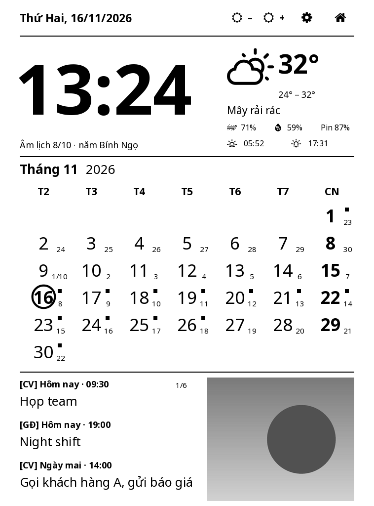

# Kindle Dashboard — biến Kindle Paperwhite 2 thành màn hình thông tin thường trực



## Kiến trúc

```
[Máy tính / Raspberry Pi]                    [Kindle PW2 đã jailbreak]
 server/dashboard_server.py  --- Wi-Fi --->   KUAL > Dashboard > Bật
 render PNG 758x1024 xám                      wget PNG -> eips vẽ lên e-ink
 (giờ, thời tiết, todo, ...)                  ngủ sâu (rtcwake) 10 phút -> lặp
```

Toàn bộ phần xử lý chạy trên server, Kindle chỉ tải ảnh về và hiển thị.
Muốn thêm widget nào (lịch, giá coin, doanh số, chỉ số server, ...) thì sửa
mỗi Python, không phải đụng gì vào Kindle.

## 1. Server

```bash
cd server
pip install -r requirements.txt
cp config.example.json config.json   # sửa thành phố, toạ độ, tiêu đề
python3 dashboard_server.py --render preview.png   # xem trước trên PC
python3 dashboard_server.py                         # chạy server :8080
```

- Thời tiết lấy từ Open-Meteo, miễn phí và không cần API key.
- Danh sách việc lấy từ `server/todo.txt`. Sửa file là lần làm mới sau sẽ cập nhật.
- Muốn có widget mới thì viết thêm vào hàm `render()`.

## 2. Kindle (PW2 firmware 5.12.2.2, đã jailbreak bằng WinterBreak2)

Mặc định **Kindle tự vẽ dashboard**, không cần máy tính:
- đồng hồ, thứ và ngày (đồng hồ của Kindle, cập nhật mỗi phút);
- **lịch tháng để bàn**, có gạch chân dưới những ngày có sự kiện;
- **sự kiện Apple Calendar** (link ICS công khai của iCloud, hoặc Google Calendar);
- thời tiết (Open-Meteo, lấy qua Wi-Fi);
- **ảnh của bạn**, đổi theo chu kỳ (`dashboard/photos/`).

Chữ được vẽ bằng FBInk (lấy từ gói KOReader) với phông Noto Sans, có đầy đủ
dấu tiếng Việt. Ảnh được vẽ bằng `eips`.

### Lịch Apple (iCloud)
Trên Mac, mở app **Lịch**, chuột phải vào lịch ở cột trái → **Chia sẻ lịch…**
→ tick **Lịch công khai** → sao chép link `webcal://…`. Dán link vào `ICS_URL`
trong `dashboard/dash.conf`. Muốn lấy nhiều lịch thì dán nhiều link, cách nhau
bằng dấu cách. Lưu ý: ai có link cũng xem được lịch đó.

Hỗ trợ: sự kiện thường, sự kiện cả ngày, giờ UTC, lặp ngày/tuần
(BYDAY)/tháng/năm, INTERVAL, COUNT, UNTIL, EXDATE. Chưa hỗ trợ các quy tắc lặp
phức tạp như "thứ Hai đầu tiên của tháng".

### Ảnh
```bash
python3 tools/prepare_photos.py ~/Pictures/cho-kindle kindle/dashboard/photos
```
Script thu nhỏ ảnh về 298x344, chuyển thang xám và lưu PNG. Sau đó chép thư
mục `photos` vào Kindle. Ảnh HEIC từ iPhone cần cài thêm `pip3 install pillow-heif`.

KUAL **không chạy** trên bộ jailbreak "hdnext", nên dashboard là các
**scriptlet**: file `.sh` trong `documents/` hiện như sách, bấm vào là chạy.

1. Cắm Kindle vào Mac và chép file:
   ```bash
   ditto --norsrc --noextattr --noacl kindle/dashboard /Volumes/Kindle/dashboard
   ditto --norsrc --noextattr --noacl kindle/documents /Volumes/Kindle/documents
   find /Volumes/Kindle -name '._*' -delete
   diskutil eject /Volumes/Kindle
   ```
2. Sửa tuỳ ý trong `/Volumes/Kindle/dashboard/`:
   - `dash.conf`: tiêu đề, thành phố và toạ độ, câu trích dẫn, chu kỳ làm mới.
   - `todo.txt`: danh sách việc.
3. Trên Kindle, trong thư viện:
   - **Dashboard - Test**: vẽ 1 lần, giao diện Kindle vẫn chạy và sẽ vẽ đè lên. Log ghi vào `dashboard/test.log`.
   - **Dashboard - Bat**: tắt giao diện Kindle, đồng hồ cập nhật mỗi phút, thời tiết mỗi 30 phút.
   - **Dashboard - Tat**: tắt dashboard (khi giao diện Kindle còn bấm được).
4. **Thoát khi đang ở dashboard**: giữ nút nguồn khoảng 20 giây để khởi
   động lại. Dashboard không tự chạy khi máy khởi động.

Muốn hiện những thứ Kindle không tự lấy được (lịch, Notion...), điền
`SERVER_URL` trong `dash.conf` để chuyển sang chế độ tải ảnh từ
`server/dashboard_server.py`.

## Pin

Ở chế độ Bat, Kindle không ngủ (đồng hồ cập nhật mỗi phút) nên pin chỉ trụ
khoảng một đến vài ngày, chưa đo trên máy thật. Muốn dùng 24/7 thì cứ để cắm
sạc. Muốn tiết kiệm pin thì tăng `REFRESH_MIN` trong `dash.conf`.

## Gỡ lỗi

- Log nằm ở `dashboard/dash.log` và `dashboard/test.log` trên Kindle.
- Log ghi rõ thời tiết lấy được qua `curl https` hay `wget http`, hoặc báo `fetch failed`.
- Chế độ server: Kindle phải vào được `SERVER_URL`. Kiểm tra IP của Mac (IP có thể đổi) và tường lửa.
